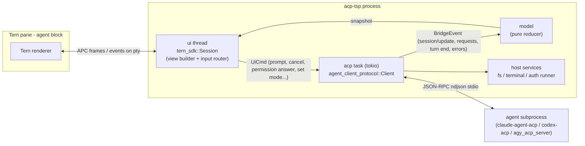

# acp-tsp — implementation plan

A Rust program that runs in a Tern **agent block**, drives any ACP agent as an ACP **client** over stdio, and renders the session natively through TSP. Targets: Claude Code, Codex, agy (Google Antigravity).

Research backing every claim below: [`docs/research/`](research/) (`tsp.md`, `acp.md`, `agents.md`, `reference-implementations.md`), all source-cited. Research date 2026-10-08.

---

## 1. Findings that shape the design

| # | Finding | Consequence |
|---|---|---|
| F1 | TSP is **not RPC**. It is an in-band UI protocol: the program writes APC strings (`ESC _ tsp;<verb>;<json> ESC \`) to its own pty; Tern answers `hello` and sends events (`e`) on the pty input. No ids, no responses besides `hello`/`blobs`. | The bridge is a terminal program. It owns the tty and the UI state; ACP semantics (requests, turns, permissions) live entirely in the bridge. |
| F2 | Tern never spawns a TSP program by protocol. Agent blocks run Tern's `agent_command` setting (`new_blocks: "Agent"`); surfaces render **only in agent blocks** (blank pane in shell blocks, no error). | Distribution = `agent_command = "acp-tsp --agent claude"`. Ship `acp-tsp setup-tern` to write that setting (with backup) and detect wrong block kind. |
| F3 | **None of the three CLIs speak ACP natively** (verified locally: `codex-cli 0.160.0`, `claude 2.1.291` have no ACP flag). ACP comes from adapters: `@agentclientprotocol/claude-agent-acp` (0.87.0), `@agentclientprotocol/codex-acp` (2.1.1, wraps `codex app-server`), and Google's proprietary `agy_acp_server` binary (registry id `antigravity-acp` 1.3.0, Linux arg `--uid=`). | Agents are launch specs from the ACP registry, not CLIs. agy needs a binary download + separate auth file (`~/.gemini/antigravity-acp/settings.json`). |
| F4 | `tern-sdk` 0.1.0 (crates.io) is **synchronous**, serde-only, edition 2024: handshake, chunking, credits (2 unacked frames), keyed view diffing, event routing, recording (`TERN_TSP_RECORD`), scripted in-memory `Terminal` for tests. | Run TSP on a dedicated OS thread; run ACP on tokio. Bridge them with channels. |
| F5 | `agent-client-protocol` 3.1.0: `Send` futures (no `LocalSet`), `Client` role builder, `AcpAgent` process spawning (own process group, bounded stderr), unstable features behind cargo flags (`unstable_session_fork`, `_plan_operations`, `_session_notices`, `_session_compaction`, `_subagents`, `_llm_providers`, `_mcp_over_acp`, `_end_turn_token_usage`, `_nes`, `_protocol_v2`). | Use 3.x; mirror each `unstable_*` flag as a cargo feature of acp-tsp. |
| F6 | Claude and Codex adapters **do not call client `terminal/*`**; they stream command output via Zed `_meta.terminal_info/output/output_delta/exit` conventions. Claude **does** call `fs/read_text_file`/`fs/write_text_file`. Codex uses neither. | Client fs is stage-1 critical (Claude). `terminal/*` is required for spec completeness (stage 2) but not exercised by target agents; `_meta.terminal_*` is the real path for them (stage 3). |
| F7 | No reference integration bridges ACP. hermes-for-tern (Python) and octet (`octet-tern`, Rust, hand-rolled) are the best TSP UX references; pi-tern documents field-verified TSP pitfalls. | Copy their scene shapes (tool cards, thought sections, checklist, composer in `dock`) and pitfalls list (§9). |

---

## 2. Architecture

- **Single crate** (`acp-tsp`, bin + lib for tests), modules:
  - `acp/` — connection, `initialize` negotiation, request handlers (permission, fs, terminal, elicitation), session commands. Only module that touches ACP types on the wire.
  - `model/` — pure state: sessions, transcript entries (user msg, agent msg, thought, tool call, plan, notice), pending interactions, capabilities, modes/config, usage. `fn apply(&mut Model, BridgeEvent)`. No IO; unit-tested directly.
  - `ui/` — `fn view(&Model, &Caps) -> tern_sdk::View<Msg>` plus key/event → `UiCmd` routing and the composer text model (UTF-16 offsets for `edit` events).
  - `host/` — fs root enforcement (`cwd` + `additionalDirectories`), terminal process manager, terminal-auth runner.
  - `agents/` — launch presets + per-agent quirk tables (stage 3).
  - `config` — `~/.config/acp-tsp/config.toml`: agents, default agent, MCP servers, permission defaults.
- **Threads**: UI thread loops `session.next(Some(tick))`, drains `crossbeam_channel` of model snapshots/events, re-renders. ACP side is a multi-thread tokio runtime; UI→ACP via `tokio::sync::mpsc::UnboundedSender` (sync `send`). Stage-1 spike decides tick vs a wake fd (§10 R1).
- **Rendering**: whole-view render through the SDK reconciler with stable keys (`turn.<n>.tool.<toolCallId>` etc.). Finished turns are `settle`d. Streaming text uses `md` with `stream:true`.
- **Fallback**: `Session::connect` → `None` (no Tern / `TERN_TSP=0` / tmux) prints a clear error and exits non-zero. A plain-text mode is out of scope unless requested.

### Region layout

| Region | Content |
|---|---|
| `main` | transcript: user cards, agent `md`, thought `section` (folded after turn), `tool` cards, `checklist` plan, notices |
| `dock` | status `seg` (agent, mode, model, usage meter, working `spinner`+`elapsed`), composer `editor` |
| `layer` | permission dialogs, pickers (commands, sessions, models/modes), `prefs` sheet, auth, elicitation forms, toasts |

---

## 3. Stack and conventions

- Rust stable, edition 2024, MSRV 1.88 (ACP crate floor). Toolchain is **not installed** on this host: install via `rustup` (or `mise use rust@stable`) in stage 0.
- Dependencies: `tern-sdk = "0.1"`, `agent-client-protocol = { version = "3.1", features = ["process"] }`, `tokio`, `crossbeam-channel`, `serde`/`serde_json`, `toml`, `clap`, `tracing` + `tracing-appender` (logs to file, **never stdout** — stdout is the pty), `anyhow`/`thiserror`, `portable-pty` (stage 2 terminals). Dev: `insta` (view JSON snapshots), `tempfile`.
- Logging: `$XDG_STATE_HOME/acp-tsp/<session>.log`; agent stderr captured into the same log.
- Git: default branch **`main`** (trunk-based). **Conventional Commits** (`feat`, `fix`, `refactor`, `test`, `docs`, `chore`, `ci`, `build`, `perf`; scope = module, e.g. `feat(acp): handle session/request_permission`). Push to `origin main` after every green commit; never leave local-only work at the end of a work item.
- CI (GitHub Actions, stage 0): `cargo fmt --check`, `cargo clippy --all-targets --all-features -D warnings`, `cargo test --all-features`, plus a conventional-commit message check on pushed commits.

---

## 4. Stages

Each stage ends with: all acceptance checks passing, coverage table (§6) updated, pushed to `main`, tagged `v0.N.0`.

### Stage 0 — Bootstrap

1. Rename branch to `main`, push, set GitHub default branch to `main`.
2. Install Rust toolchain; `cargo init`; module skeleton; `.gitignore`; MIT/Apache license (decide, §10 D3).
3. CI workflow as in §3.
4. **Spike** (throwaway, not merged): tern-sdk session in this pane rendering a streamed `md` driven from a tokio task through a channel; measures latency/CPU of tick polling (§10 R1). Second spike: `AcpAgent::claude_agent()` + `codex()` `initialize` round-trip, dumping the real `InitializeResponse` into `docs/research/agents.md`.

Acceptance: CI green on `main`; spike results recorded in this file.

**Results (2026-10-08):**
- Wake: `bus::WakeTerm` polls stdin plus a socketpair and injects a synthetic `{"ev":"wake"}` TSP event, so `Session::next(None)` returns as soon as ACP sends an event. Measured in a real Tern 0.6.2 pane (`tern new session … -- spike`): 400 events at 2 ms spacing, p50 0.049 ms, p99 0.132 ms, max 0.160 ms send→drain, no polling tick. R1 closed.
- Tern 0.6.2 `hello` features: `blobs settle adopt dock program-palette reduce-motion aside scroll styles flow`.
- Real `initialize` responses (clientCapabilities fs+terminal): `claude-agent-acp` 0.87.0 → `loadSession`, image+embeddedContext, MCP http+sse, `auth.logout`, `providers`, session `additionalDirectories close delete fork list resume subagents`, `_meta.claudeCode.promptQueueing`, `_meta.steering.supported`, **no `authMethods`** unless `auth.terminal` is advertised; `codex-acp` 2.1.1 → same session caps, MCP http only (`acp:false`), authMethods `api-key`, `chat-gpt`. Both push `_auth/status_update` right after `initialize` (contains account e-mail: never log raw wire by default).
- e2e harness: a hidden `tern new session` pane is never drawn by a window, so no `ack`s arrive and nothing renders. Headless `tern serve` does draw TSP surfaces in its shell pane (acks arrive, `tern ctl tree` exposes surface text; `ctl type`/`ctl key` drive the composer). Wrapped as `scripts/tern-e2e.sh`. Limits: headless ignores `settings.json` (agent blocks run the user's default `omp`), and Ctrl combinations don't reach the pty.

**Stage 1 live smoke (2026-10-08, headless Tern 0.6.2):** Claude 0.87.0 — prompt → `Read` tool card with output → answer. Codex 2.1.1 — command tool call + answer; with `INITIAL_AGENT_MODE=read-only` the permission dialog shows the agent's 3 options, `1` approves and the file is written; Escape during a 60 s command ends the turn `Cancelled`.

### Stage 1 — Basics (usable chat with Claude and Codex)

ACP:
- `initialize` (protocol v1; `clientInfo`; `clientCapabilities.fs.{readTextFile,writeTextFile}=true`; terminal/elicitation/auth off until implemented), store `agentCapabilities`, `authMethods`.
- `authenticate` for `type:"agent"` methods (picker in `layer` when the agent returns `-32000 AuthRequired` or lists methods); auth errors rendered.
- `session/new` (cwd = launch dir; `mcpServers: []`), `session/prompt` with `text` blocks, `session/cancel`, `StopReason` handling (`end_turn`, `max_tokens`, `max_turn_requests`, `refusal`, `cancelled`), JSON-RPC errors.
- `session/update`: `agent_message_chunk`, `user_message_chunk`, `agent_thought_chunk` (grouped by `messageId` when present), `tool_call`, `tool_call_update` (status, title, kind, `content` text/`diff`, `locations`, `rawInput`/`rawOutput` collapsed), `plan`.
- `session/request_permission` → dialog with the agent's options (`allow_once`/`allow_always`/`reject_once`/`reject_always`), keyboard + click; on cancel answer `cancelled` (spec MUST).
- `fs/read_text_file` (`line`/`limit`), `fs/write_text_file`, confined to session roots; absolute-path validation; errors as JSON-RPC errors.
- Agent process lifecycle: spawn from preset, stderr to log, crash → visible error + restart action; clean shutdown kills the process group.

TSP/UI:
- Handshake (`app: "acp-tsp"`, features `edit`, `undo`, `send`), inline surface, palette, regions per §2.
- Composer `editor` in `dock`: typing, `edit`/`undo` events, paste, Enter submits, Shift+Enter newline, `send` events submit, history (↑/↓).
- Transcript nodes per §2; tool `status` mapping `pending→pending`, `in_progress→running`, `completed→done`, `failed→error`, cancelled turn → `cancelled`; `diff` content → `diff` node; text → `md`/`code`.
- Plan → `checklist` (`pending→pending`, `in_progress→active`, `completed→done`).
- Working indicator (spinner/shimmer/elapsed) from prompt send until `PromptResponse`; Esc/Ctrl+C cancels a turn; Ctrl+C twice / Ctrl+D on empty composer exits.
- Credit-aware streaming (SDK queues; verify no frame storms), `error` events logged, `gone` handled.
- CLI: `acp-tsp [--agent NAME] [--cwd DIR] [-- CMD ARGS…]` (ad-hoc command), `acp-tsp setup-tern [--agent NAME]`, `acp-tsp agents`.
- Presets: `claude` → `npx -y @agentclientprotocol/claude-agent-acp@0.87.0`, `codex` → `npx -y @agentclientprotocol/codex-acp@2.1.1` (pinned; bump deliberately).

Acceptance:
- Integration tests: in-process fake agent (ACP `Agent` role over `Channel` transport) scripted to stream text/thought/tool calls/plan, request permission, read/write a temp file, and honour cancel; UI driven by tern-sdk scripted `Terminal`; assertions on model state and emitted frames.
- Manual smoke in a real Tern agent block with Claude and Codex: prompt → streamed answer; a file edit asking permission → allow → diff shown; cancel mid-turn → `cancelled` and tool cards marked; Claude reads a file through `fs/read_text_file` (log shows the request).

### Stage 2 — Complex features (rest of stable v1, then unstable)

Stable v1:
1. **Terminals**: `clientCapabilities.terminal=true`; `terminal/create` (command, args, env, cwd, `outputByteLimit` truncation at char boundary), `terminal/output`, `terminal/wait_for_exit`, `terminal/kill`, `terminal/release`; `terminal` tool-call content embeds live `ansi` output in the tool card.
2. **Session lifecycle**: `session/list` (paged picker, `cursor`), `session/load` (render replayed `session/update` history), `session/resume` (no replay), `session/close`, `session/delete`, `additionalDirectories` (CLI `--add-dir`), `session_info_update` (title → surface title / tab), `--resume <id>` and `--continue`.
3. **Modes and config options**: `modes` from session setup, `session/set_mode`, `current_mode_update`; `configOptions` (select + boolean with `clientCapabilities.session.configOptions.boolean`), `session/set_config_option`, `config_option_update`; dock chips + `prefs` sheet; Shift+Tab cycles mode.
4. **Slash commands**: `available_commands_update` → completion picker on `/`, `input.hint` placeholder; command sent as prompt text.
5. **Rich prompt content**: `resource_link` via `@path` mentions (file picker over cwd), embedded `resource` when `embeddedContext`, `image` (clipboard paste/attach, sent only if `promptCapabilities.image`; rendered via TSP blobs), `audio` gated by `promptCapabilities.audio`. Rendering of all content block kinds in agent output (image → `image` node, resource links → `md` links).
6. **MCP servers**: config-defined stdio/http/sse servers passed to `session/new|load|resume`, filtered by `mcpCapabilities`.
7. **Elicitation**: `elicitation/create` form mode (JSON-schema subset → `el` form) and URL mode (open link + wait), `elicitation/complete`; advertise `clientCapabilities.elicitation.{form,url}`.
8. **Auth completeness**: `type:"terminal"` auth methods (`clientCapabilities.auth.terminal`) — suspend the surface (`suspend`), run the agent's command interactively on the pty, resume; `logout` when `agentCapabilities.auth.logout`.
9. **Usage**: `usage_update` → `agent` stats/context `meter` + cost.
10. **Request cancellation**: send `$/cancel_request` for abandoned client requests; honour incoming `$/cancel_request` for permission/fs/terminal/elicitation (respond `-32800`).

Unstable (each behind the matching cargo feature, default **on** in release builds once tested against an agent that emits it):
11. `session/fork` (`unstable_session_fork`) — fork from a turn.
12. `plan_update` / `plan_removed` + `clientCapabilities.plan` (`unstable_plan_operations`) — Codex uses this for plan mode.
13. `notice` + `session.notices` (`unstable_session_notices`) → toasts.
14. `compaction_update` / `compaction_summary_chunk` + `session.compaction` (`unstable_session_compaction`).
15. Subagents: `subagent_update`, `session_message`, `session_message_chunk` + `clientCapabilities.subagents` (`unstable_subagents`) → nested `agent` nodes (depth).
16. `providers/list|set|disable` (`unstable_llm_providers`) → prefs page.
17. End-turn token usage (`unstable_end_turn_token_usage`).
18. MCP-over-ACP `mcp/message` (`unstable_mcp_over_acp`) — lets acp-tsp expose its own MCP tools (e.g. "open file in Tern") to the agent.
19. NES (`nes/*`, `document/*`) and draft protocol v2 — see §10 D2.

Acceptance: fake-agent integration test per item; manual smoke of items 2–5, 7, 9, 12, 15 against Claude and Codex (both advertise list/resume/close/delete/fork/subagents per `docs/research/agents.md`).

**Stage 2 results (2026-10-08):** items 1–18 implemented with fake-agent integration tests (90 tests total). Live smoke in headless Tern 0.6.2:
- Claude 0.87.0: slash palette (84 agent commands + client commands), `/sessions` list → load with replayed history, config chips (mode/model/effort) and `/config` sheet, AskUserQuestion form elicitation answered by clicking a radio + Accept (agent received `"Coffee"`), `session_info_update` title, `usage_update` meter + cost, end-turn token line, `@main.rs` mention answered from the file.
- Codex 2.1.1: Shift+Tab cycles the `mode` config option (Auto review → Full access).
- Bugs found live and fixed with regression tests: layer pickers given as region roots were invisible (region roots draw no element), dialogs floated without backdrop (now modal `overlay`s), Shift+Tab never matched, palette ranked description matches above names, batched/pasted `/command` input did not reach the palette.
- Known gaps: the in-process `tern` MCP server attaches to `session/new` only (SDK 3.1 exposes no public per-session MCP attachment for load/resume/fork); client terminals (`terminal/*`) are exercised only by fake agents because neither target adapter calls them.
- Item 19 (NES, draft v2): not implemented (see D2).

### Stage 3 — Agent-specific features and deviations

Shared adapter conventions (Claude + Codex):
- `_meta.terminal_info` / `terminal_output` / `terminal_output_delta` / `terminal_exit` → live `ansi` body in tool cards (this is how both adapters stream shell output; advertise via `clientCapabilities._meta.terminal_output`).
- `_meta["terminal-auth"]` auth hint; `_meta.authStatus` + `_auth/status_update`.
- Steering (`_meta.steering.supported`, `_session/steering`): send a message mid-turn instead of queueing.
- `quota`, `is_mcp_tool_call`, `mcp_output_delta`.

Claude (`claude-agent-acp`):
- `_meta.claudeCode.toolName` / `parentToolUseId` (nest subagent tool calls under `Agent`/`Task` cards) / `toolResponse`.
- `_meta.claudeCode.promptQueueing` → allow typing next prompt during a turn.
- `_claude/sdkMessage`, `_claude/rateLimit` (rate-limit banner), `_claude/model`, `_claude/origin`.
- ExitPlanMode permission option ids (`exit-plan-*`) → plan-approval dialog showing the plan; AskUserQuestion via form elicitation incl. custom answer.
- Modes `default/acceptEdits/plan/auto/bypassPermissions`; `allowDangerouslySkipPermissions` via `_meta.claudeCode.options` (config-gated).
- Auth: `claude-ai-login`, `console-login` terminal methods.

Codex (`codex-acp`):
- Auth methods `api-key`, `chat-gpt`, `chat-gpt-device-code` (URL elicitation), `gateway` (opt-in `clientCapabilities.auth._meta.gateway`).
- Env passthrough in preset config: `INITIAL_AGENT_MODE`, `CODEX_CONFIG`, `MODEL_PROVIDER`, `CODEX_PATH`, `NO_BROWSER`.
- Plan-review tool call (`kind: switch_mode`, `implement_plan`/`revise_plan`), `/review*`, `/goal` + `_session/goal`, `_session/async_task/stop`, `$skill` commands, `_meta.codex.error`.
- Permission sets that fail closed (`cancel`) rendered as such.

agy (`agy_acp_server`):
- Installer: `acp-tsp agents install agy` downloads the registry archive for the platform, verifies sha256 when provided, stores under `~/.local/share/acp-tsp/agents/agy/`; preset passes `--uid=` on Linux.
- Auth setup helper for `~/.gemini/antigravity-acp/settings.json` (`oauth-personal | gemini-api-key | oauth-business | agent-platform`); explain the one-time browser login.
- Capability discovery: run `acp-tsp probe agy`, record the real `InitializeResponse` + a scripted session transcript, then fill the agy column of §5 and implement any deviations found. Until probed, agy runs on the generic stable-v1 path only.
- ToS notice (Google FAQ forbids third-party access to Antigravity accounts) shown once at install.

JetBrains AIR `_meta.jetbrains.air.*`: not advertised (AIR-client-only; adapters emit it only when the client identifies as AIR). Revisit only if a needed feature is AIR-gated.

Acceptance: recorded ACP transcripts (JSONL via `AcpAgent::with_debug`) per agent committed as fixtures under `tests/fixtures/<agent>/`; replay tests feed them through the model + view; manual smoke of each listed feature per agent.

**Stage 3 results (2026-10-08):** implemented as listed above, with these source-verified findings and decisions:
- Both adapters key on `clientCapabilities._meta.terminal_output` (Claude also on `_meta["terminal-auth"]`). Live: Codex `printf` output and a Claude `bash` loop stream into their tool cards with exit chips.
- Steering params: `{sessionId, prompt, _meta: {steering: {idleBehavior: "promptRequired"}}}`. Live with Claude: a message sent during a running bash loop was answered in the same turn. Codex 2.1.1 ignores `idleBehavior` (detached-turn race), so acp-tsp queues for Codex (`quirks::steering`).
- Codex `api-key` auth reads `CODEX_API_KEY`, then `OPENAI_API_KEY` (or `authenticate._meta["api-key"].apiKey`); acp-tsp relies on the environment and never prompts for or records keys.
- Goal (`_session/goal`) and async-task controls are advertised by both adapters only to JetBrains AIR clients; acp-tsp does not claim AIR, so the agents' own `/goal` command remains the path.
- `_auth/status_update` → account chip (e-mail only in the details sheet). Recorder (`ACP_TSP_RECORD`) redacts auth status, e-mails, API keys/tokens and MCP `env`/`headers`; files are created `0600`.
- Fixtures: `tests/fixtures/claude/read_and_list.jsonl`, `tests/fixtures/codex/{command,read_only_plan}.jsonl` replayed through ACP → model → view in `tests/replay_agents.rs`.
- agy — **acceptance deferred (blocked on host)**: `acp-tsp agents install agy` installs registry 1.3.0 from `dl.google.com` over HTTPS; the registry publishes no checksum, so the download is not integrity-verified beyond TLS (the installer says so). `agy_acp_server.par` 1.3.0 (linux-x86_64) dies with `SIGILL` (`ILL_ILLOPN`) on this host (Proxmox LXC, i5-13600K) before speaking ACP; the cause (CPU feature vs. environment) is unconfirmed. No agy fixture, replay test or live smoke exists; the agy column of §5 stays unverified until `acp-tsp probe --agent agy` and a smoke run succeed on another host.
- The Codex steering quirk applies to every `codex-acp` version on purpose: re-check `idleBehavior` handling whenever the Codex preset is bumped and drop the quirk once the adapter honours it.
- Live-found polish: Tern hides status segments that overflow; the dock now drops steady-state text so mode/model/effort chips stay visible.

---

## 5. Agent capability matrix (source-confirmed; agy pending probe)

| Feature | Claude adapter | Codex adapter | agy server |
|---|---|---|---|
| Launch | `npx -y @agentclientprotocol/claude-agent-acp@0.87.0` | `npx -y @agentclientprotocol/codex-acp@2.1.1` | `agy_acp_server.par --uid=` (Linux) |
| `loadSession` | yes | yes | ? |
| list / resume / close / delete / fork | yes (fork as `unstable_forkSession`) | yes | ? |
| prompt image / audio / embeddedContext | yes / no / yes | yes / no / yes | ? |
| MCP http / sse | yes / yes | yes / no | ? |
| client `fs/*` | **used** | not used | ? |
| client `terminal/*` | not used (uses `_meta.terminal_*`) | not used (uses `_meta.terminal_*`) | ? |
| modes | default, acceptEdits, plan, auto, bypassPermissions | read-only, workspace-write, agent, agent-full-access | ? |
| config options | mode, model, effort | mode, model, reasoning_effort | ? |
| elicitation | form (AskUserQuestion), url (MCP OAuth) | url (auth, MCP) | ? |
| plan | `plan` (TodoWrite) | `plan` + `plan_update` (draft) | ? |
| usage_update | yes | yes | ? |
| subagents / notices / compaction | yes (draft, opt-in caps) | yes (draft, opt-in caps) | ? |
| providers API | yes (unstable) | yes | ? |
| auth | terminal: claude-ai-login, console-login | api-key, chat-gpt, device-code, gateway | agent (settings.json) |
| extensions | `_meta.claudeCode.*`, `_claude/*`, steering | `_session/goal`, `_session/async_task/stop`, `_codex/session/set_model`, steering | ? |

---

## 6. ACP coverage checklist (every method / notification / update → stage)

| Item | Dir | Stage |
|---|---|---|
| `initialize` | C→A | 1 |
| `authenticate` (agent type) | C→A | 1 |
| `authenticate` (terminal type), `logout` | C→A | 2 |
| `session/new`, `session/prompt`, `session/cancel` | C→A | 1 |
| `session/load`, `session/resume`, `session/list`, `session/close`, `session/delete` | C→A | 2 |
| `session/set_mode`, `session/set_config_option` | C→A | 2 |
| `session/fork` (unstable) | C→A | 2 |
| `providers/list|set|disable` (unstable) | C→A | 2 |
| `nes/*`, `document/*` (unstable) | C→A | 2 (D2) |
| `session/request_permission` | A→C | 1 |
| `fs/read_text_file`, `fs/write_text_file` | A→C | 1 |
| `terminal/create|output|wait_for_exit|kill|release` | A→C | 2 |
| `elicitation/create`, `elicitation/complete` | A→C | 2 |
| `mcp/message` (unstable) | both | 2 |
| `$/cancel_request` | both | 2 |
| `_`-prefixed extension methods (unknown → `-32601` / ignore) | both | 1 (generic), 3 (specific) |
| updates: `user_message_chunk`, `agent_message_chunk`, `agent_thought_chunk`, `tool_call`, `tool_call_update`, `plan` | A→C | 1 |
| updates: `available_commands_update`, `current_mode_update`, `config_option_update`, `session_info_update`, `usage_update` | A→C | 2 |
| updates (unstable): `plan_update`, `plan_removed`, `notice`, `compaction_update`, `compaction_summary_chunk`, `subagent_update`, `session_message`, `session_message_chunk` | A→C | 2 |
| content blocks: text, resource_link (stage 1 render), image, audio, resource | both | 1 / 2 |
| tool content: content, diff (1), terminal (2) | A→C | 1 / 2 |

---

## 7. Testing strategy

- **Model**: unit tests on `apply()` for ordering edge cases (update for unknown `toolCallId`, chunks after cancel, plan replacement, `messageId` grouping).
- **View**: `insta` snapshots of the view JSON for representative models (stable keys, no duplicate ids — octet hit `duplicate id` crashes).
- **Integration**: fake ACP agent in-process (ACP `Agent` role, `Channel` transport) × tern-sdk scripted `Terminal`; assert ACP responses (permission outcome, fs results, cancel → `cancelled`) and TSP frames.
- **Fixture replay** (stage 3): recorded real-agent JSONL transcripts.
- **Live e2e** (manual / opt-in, needs auth): real Tern agent block; `TERN_TSP_RECORD` + `tern surface-play` for repro; `tern serve` + `tern ctl tree` headless where agent blocks are hostable (pi-tern found harness limits — verify in stage 0).

---

## 8. Mapping cheat-sheet (ACP → TSP)

| ACP | TSP |
|---|---|
| agent message chunks | `md` (stream) in an assistant card, `text append` |
| thought chunks | `section` + muted `md`, shimmer while streaming, folded "thought for Ns" |
| `tool_call` / update | `tool` (`name`/`title`/`target`/`status`/`age`/`took`/`exit`), body `diff` / `code` / `ansi` |
| `plan` | `checklist` (full in main, `hud` in dock) |
| permission request | `layer` card with buttons (`el` button actions) + digit keys |
| modes / config / models | dock `seg` chips + `prefs` sheet / `picker` |
| commands | `picker` on `/` |
| usage | `agent` stats (`context` meter, tokens, cost) |
| errors / notices | `card tone:error` / `toast` |
| session list | `picker` |
| elicitation | `el` form / link card |

---

## 9. Known TSP pitfalls (from pi-tern / octet field notes)

- Regions must be added as children of the surface id; otherwise `unknown id main` and a blank pane (SDK handles this — don't bypass it with raw ops).
- Surfaces draw only in agent blocks; detect and warn.
- Advertise `edit` in `hello` or native selection editing is disabled; `edit` offsets are UTF-16 and must be validated against `len`.
- Child ids must derive from stable parent ids (duplicate ids drop frames).
- `listen:false` still receives `error` events (Tern 0.5.0).
- Only `md` carries clickable `file://` links.
- Never print to stdout outside the SDK; Node warnings from `npx` go to the agent's stderr, which we capture.

---

## 10. Risks and decisions

| ID | Item | Default decision |
|---|---|---|
| R1 | tern-sdk is sync and owns the tty; waking the UI thread on ACP events. | **Closed**: wakeable `Terminal` wrapper (`bus::WakeTerm`), sub-millisecond latency (stage 0 results). |
| R2 | Whole-view re-render cost grows with transcript length during token streaming. | Credits coalesce renders; settle finished turns; if profiling shows cost, send raw `text append` ops for the streaming leaf via `Session::send`. |
| R3 | agy server is proprietary, undocumented, and Google's ToS discourages third-party access. | Support via registry binary + probe-driven quirks; show ToS notice; no PTY-scraping adapter. |
| R4 | Adapter versions move fast (codex-acp 1.x→2.x). | Pin preset versions; per-agent fixture replay catches regressions on bump. |
| R5 | Tern 0.6.2 is closed beta; TSP v1 may change. | Pin `tern-sdk`; record/replay tests; degrade on unknown kinds via `hello.kinds`. |
| D1 | Fallback outside Tern. | Error and exit (TSP is the product). Plain-text mode only on request. |
| D2 | NES (`nes/*`, `document/*`) and draft ACP v2 target editors with open documents; Tern has no document model to drive them. | **Not implemented.** NES needs an editor that owns open documents and cursor positions; a Tern agent block has neither (file blocks are not exposed to programs). Draft v2 is not a released protocol and no target adapter requires it (Claude serves it only behind `CLAUDE_AGENT_ACP_EXPERIMENTAL_V2=1`). Revisit when v2 ships or Tern exposes file-block state. |
| D3 | License. | MIT (matches tern-sdk and reference integrations). |
| D4 | Agent launch pinning vs `@latest`. | Pinned versions in presets; `acp-tsp agents update` bumps from the registry index. |
